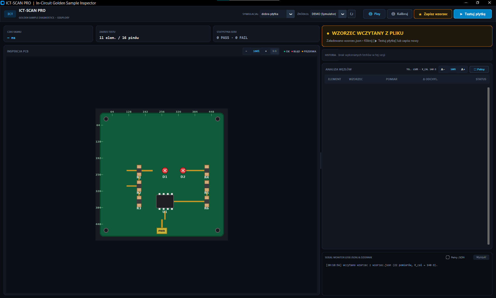

# ICT-SCAN PRO — Aplikacja Diagnostyczna PCB (Golden Sample)

Aplikacja komputerowa do niskokosztowego, automatycznego testera płytek drukowanych (In-Circuit Test) powstającego w ramach konkursu naukowego **E(x)plory** (Technikum Mechatroniczne nr 1 w Warszawie).



## Skład projektu i powiązane repozytoria
* **Aplikacja PC (to repozytorium):** Jakub Cyranowski — interfejs diagnostyczny, algorytm *Golden Sample*, konfigurator mapy pinów, Serial Monitor USB, eksport CSV.
* **Firmware ESP32 & Generator kaset 3D:** Artem Bihdash — *(wklej tu link do repo Artema)*
* **Hardware & Mechanika 3D:** Daniel Gidrewicz — płyta bazowa (`ESP32` + `2× CD74HC4067`), praska z igłami *pogo-pin*, płytki testowe PCB.

## Główne funkcje
* **Porównanie z płytką wzorcową (*Golden Sample*):** wykrywa zwarcia linii zasilania (`VCC–GND`), przerwy/zimne luty, błędne wartości rezystorów (`±10%`) oraz odwróconą polaryzację diod/LED (pomiar dwukierunkowy `< 1 mA` przed podaniem głównego zasilania).
* **Wbudowany Serial Monitor (USB `115200` baud):** odbiera dane w formacie JSON oraz pozwala wysyłać ręczne komendy diagnostyczne.
* **Konfigurator pinów (`⚙ Piny`):** klikasz bezpośrednio na zdjęcie płytki PCB, wybierasz piny `0–15` i zapisujesz `lista_elementow.json` bez ręcznej edycji kodu.
* **Tarowanie kabli (`⚙ Kalibruj`):** mierzy i odejmuje opór własny przewodów oraz multiplekserów (`R_cal`).
* **Tryb DEMO:** pełna symulacja usterek bez podpiętego sprzętu.

## Uruchomienie
```bash
pip install -r requirements.txt
python testuj_plytke.py
```