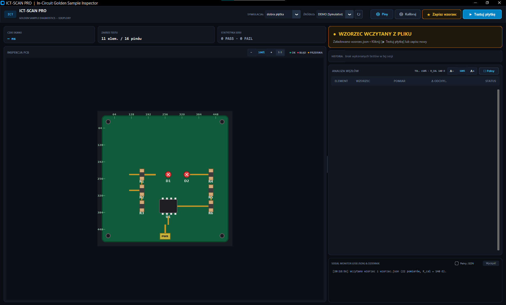

<div align="center">

# ICT-SCAN PRO

**Aplikacja Diagnostyczna i Optyczny Inspektor Błędów dla Niskokosztowego Testera Płytek PCB (ICT)**


plory-F59E0B?style=flat-square)

[🇬🇧 English](README.md) | **🇵🇱 Polski**

</div>

---

**ICT-SCAN PRO** to aplikacja komputerowa do otwartej, niskokosztowej stacji diagnostycznej In-Circuit Test (ICT), stworzonej z myślą o szkolnych pracowniach elektronicznych, kołach naukowych i prototypowaniu małych serii. Dzięki metodzie porównawczej **Golden Sample** system wykrywa błędy montażowe w ok. 1 sekundę bezpiecznym mikroprądem (`< 1 mA`), **zanim do płytki zostanie podłączone główne zasilanie**.



---

## Ekosystem projektu

| Moduł | Rola w systemie | Repozytorium / Sprzęt |
| :--- | :--- | :--- |
| **Aplikacja diagnostyczna PC** | Porównanie *Golden Sample*, wizualna mapa błędów na PCB, Serial Monitor USB, konfigurator pinów, eksport CSV | **To repozytorium** |
| **Generator kaset 3D i mapy pinów** | Generuje kasety pod igły do druku 3D (`.stl`), `wiring_guide.txt` oraz `lista_elementow.json` z plików Gerber/Excellon | [Btema2/ict-jig-gen](https://github.com/Btema2/ict-jig-gen) |
| **Stacja bazowa i firmware** | `ESP32` + `2× CD74HC4067` spięte równolegle do `16` wspólnych igieł sprężynowych (`P75-B1`) | Własna płyta bazowa |

---

## Zasada działania

Zamiast mierzyć pojedyncze elementy w izolacji (co na zlutowanej płytce nie działa przez rozpływ prądu po równoległych ścieżkach), tester bada pary igieł **w obu kierunkach (`a→b` oraz `b→a`)** przez dzielnik `3,3 V` (`R_ref = 3,3 kΩ`, maksymalny prąd zwarcia `< 1 mA`):

```text
3,3 V ──[ R_ref 3,3 kΩ ]──┬──[ MUX A ]──► Igła A ──[ Układ na PCB ]── Igła B ──[ MUX B ]── GND
                          │
                     ESP32 ADC (mV)
```

1. **Kalibracja (`⚙ Kalibruj`):** Mierzy opór własny kabli i multiplekserów (`R_cal`) na zwartej parze igieł i odejmuje go programowo (jak tarowanie wagi).
2. **Zapis wzorca (`★ Zapisz wzorzec`):** Zapisuje „odcisk palca” jednej sprawnej płytki wzorcowej do `wzorzec.json`.
3. **Test płytek (`▶ Testuj płytkę`):** Porównuje kolejne płytki ze wzorcem w tolerancji `±10%` i nanosi wyniki bezpośrednio na zdjęcie PCB.

### Klasyfikacja wyników

| Status | Warunek | Znaczenie |
| :--- | :--- | :--- |
| `OK` | W granicach tolerancji `±10%` (lub zgodna polaryzacja diody) | Element / ścieżka zgodna ze wzorcem |
| `ZWARCIE` / `ZWARCIE LINII` | Spadek oporu `< 15 Ω` (lub `< 10%` wartości wzorca) | Zwarcie lub mostek cyny (np. na szynie `VCC–GND`) |
| `PRZERWA` | Obwód otwarty (`≥ 3050 mV` na ADC), gdy wzorzec przewodził | Brak styku, przerwana ścieżka lub zimny lut |
| `ZŁA WARTOŚĆ` | Odchyłka rezystancji przekracza `±10%` | Wlutowany rezystor o błędnej wartości |
| `ODWRÓCONA` | Odczyty `a→b / b→a` zamieniły się miejscami względem wzorca | Odwrotnie wlutowana dioda lub LED |
| `PRZEBICIE` | Wzorzec był otwarty, badana płytka przewodzi (`≥ 15 Ω`) | Niepożądane przejście między węzłami |
| `BLISKO GRANICY` | Odchyłka między `±5%` a `±10%` | Wartość na granicy tolerancji |

---

## Główne funkcje

* **Wbudowany Serial Monitor USB:** Nieblokujący odbiornik JSON (`115200` baud, timeout `4,5 s`) z podglądem surowych linii `RX/TX`, ręcznym wysyłaniem komend (`SCAN`, `PING`) i odświeżaniem portów COM (`↻`).
* **Konfigurator pinów (`⚙ Piny`):** Klikasz bezpośrednio na zdjęcie płytki PCB, wybierasz piny `0–15` oraz typ (`element` / `linia`) i zapisujesz prosto do `lista_elementow.json`.
* **Interaktywny podgląd i skalowanie:** Zoom kółkiem myszy (`55%–200%`), przesuwanie płytki, przeciągany podział ekranu, skalowanie tabeli (`85%–130%`), tryb pełnoekranowy tabeli (`⛶ Pełny`).
* **Historia skanów i eksport CSV:** Podgląd ostatnich 10 skanów i automatyczny zapis do `pomiary_raport.csv` (ze średnikiem pod polski Excel).
* **Tryb DEMO:** Wbudowany symulator usterek (`dobra płytka`, `zwarcie`, `zly_rezystor`, `odwrocona_dioda`, `przerwa`) do pracy bez sprzętu.

---

## Instalacja i uruchomienie

### Windows / macOS
```bash
pip install -r requirements.txt
python testuj_plytke.py
```
*(Na Windowsie można też kliknąć dwa razy `URUCHOM_WINDOWS.bat`).*

### Linux (Fedora / Ubuntu / Debian)
Przed uruchomieniem wymagane są pakiety systemowe dla `Tkinter` i `ImageTk`:
* **Fedora:** `sudo dnf install python3-tkinter python3-pillow-tk`
* **Ubuntu / Debian:** `sudo apt install python3-tk python3-pil.imagetk`

```bash
pip3 install -r requirements.txt
python3 testuj_plytke.py
```

---

## Protokół USB i format konfiguracji

Po wysłaniu komendy `SCAN\n` przez USB (`115200` baud) mikrokontroler zwraca jedną linię JSON:
```json
{
  "board_id": "test_01",
  "scan_ms": 850,
  "readings": [
    {"a": 0, "b": 1, "mv": 472},
    {"a": 1, "b": 0, "mv": 474}
  ]
}
```

Format pliku `lista_elementow.json` (kompatybilny z generatorem `ict-jig-gen`):
```json
{
  "elementy": [
    {"nazwa": "R1", "piny": [0, 1], "x": 168, "y": 240, "typ": "element"},
    {"nazwa": "VCC-GND", "piny": [0, 15], "x": 256, "y": 452, "typ": "linia"}
  ]
}
```

## Zawartość repozytorium

| Plik | Opis |
| :--- | :--- |
| `testuj_plytke.py` | Główna aplikacja GUI (`ICT-SCAN PRO`) |
| `lista_elementow.json` | Przykładowa mapa elementów, pinów i współrzędnych (x, y) |
| `zdjecie_plytki.png` | Zdjęcie płytki z góry pod mapę błędów |
| `requirements.txt` | Zależności Pythona (`customtkinter`, `pillow`, `pyserial`) |
| `URUCHOM_WINDOWS.bat` / `URUCHOM.sh` | Skrypty startowe |
| `PRZECZYTAJ.txt` | Krótka instrukcja obsługi po polsku |